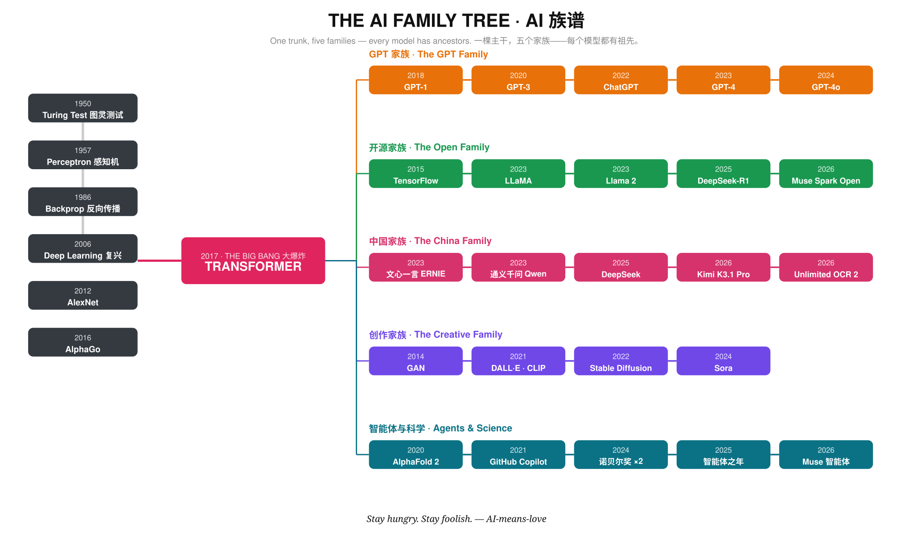

# AI 族谱 · The AI Family Tree

[EN](../../FAMILY.md) · **ZH-CN**

▶ **看视频：21 秒漫游族谱** —— [assets/family-tree-tour.mp4](../../assets/family-tree-tour.mp4)

## 怎么读这张图

你用过的每个模型，都有祖先。这张图从左往右读：

- **主干（灰色）**——老想法们：图灵测试（1950）、感知机（1957）、反向传播（1986）、深度学习复兴（2006）、AlexNet（2012）与 AlphaGo（2016）。
- **大爆炸（红色）**——2017 年的一篇论文《Attention Is All You Need》带来了 **Transformer**。今天活着的模型，几乎都是它的后代。
- **五个家族（彩色）**——Transformer 的子孙，各有各的脾气。

图上每个节点，都是 [时间线](TIMELINE.md) 里带日期和来源的一条记录。

## 五个家族

**🟠 GPT 家族——最有名的长子。**
GPT-1（2018）当年只是个低调的研究模型；它的孙辈 ChatGPT（2022）两个月把 AI 介绍给了一亿人，GPT-4 / GPT-4o 则让这一家成了全世界的默认助手。

**🟢 开源家族——最慷慨的一支。**
TensorFlow（2015）送出了工具，LLaMA（2023）送出了模型本身。DeepSeek-R1（2025）证明开放权重也能在前沿推理，Muse Spark Open（2026）延续了传统：这一家的家训是「拿去，自己跑，它是你的」。

**🩷 中国家族——跑得最快的一支。**
文心一言与通义千问在 2023 年 GPT-4 发布后几周内相继到来；到 2025–26 年，这一支开始自己创造纪录：DeepSeek 的效率、Kimi K3.1 Pro 的 2.8 万亿参数开放旗舰、百度 Unlimited OCR 2 一次读完整个档案库。

**🟣 创作家族——艺术家们。**
GAN（2014）教会机器想象；DALL·E 与 CLIP（2021）把文字和图像接通；Stable Diffusion（2022）把图像生成搬进家用电脑；Sora（2024）把想象力延伸到了视频。

**🔵 智能体与科学——动手做事的一支。**
AlphaFold 2（2020）折叠蛋白质，把 AI 送向两座诺贝尔奖（2024）；Copilot（2021）住进了编辑器；到 2025 年智能体开始做多步骤的工作，2026 年 Muse 这样的个人智能体到来——不只是回答，而是行动。

## 一句话记住

> 主干是数学，大爆炸是注意力，枝叶是选择：闭源还是开源，聊天还是创作，回答还是行动。

*另见：[Logo 进化史](LOGOS.md)——那些著名标志是怎么长大的。*
