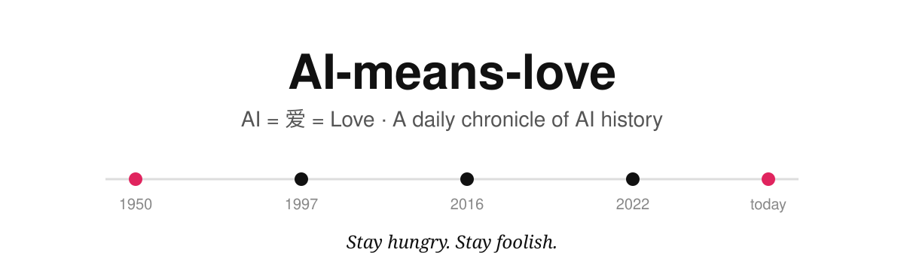

# AI-means-love ❤️



[EN](../../README.md) · [ZH-CN](../zh-CN/README.md) · **ZH-TW** · [JA](../ja/README.md) · [KO](../ko/README.md) · [ES](../es/README.md) · [FR](../fr/README.md) · [DE](../de/README.md) · [PT](../pt-BR/README.md) · [RU](../ru/README.md)

> **我們的根基：Stay hungry. Stay foolish.** · *Simplicity is the ultimate sophistication.（至繁歸於至簡）* — Steve Jobs


> **AI，就是「愛」。**
> AI 的發音是「愛」——我們相信，記錄人工智慧的每一步進步，最終是為了記錄人類如何用智慧去幫助人、治癒人、連線人。

一個持續更新的 **AI 發展史公開檔案**：先系統回填從 1950 年圖靈測試至今的關鍵節點，此後 **每日更新一條** 經核查的 AI 進展。不追熱點、不編故事，只做一件有意義的事——把世界進步的樣子，一天一天記下來。

## 這個專案做什麼

1. **一部可核查的 AI 編年史** —— `TIMELINE.md`
   每個節點包含：日期、事件、發生了什麼、**為什麼重要 / 它帶來的善**、來源。日期精確到日（能核實到日的），不確定的只寫到月，絕不編造。
2. **一份結構化資料** —— `data/events.json`
   同一份歷史以機器可讀格式儲存，未來可以直接生成網頁時間軸、圖表、影片指令碼和每日推送。
3. **每日一記** —— `daily/YYYY-MM-DD.md`
   每天只選當天最值得被歷史記住的 **1 條**（寧缺毋濫；沒有夠格的事件，就如實寫「今日無收錄」並說明原因）。

## 收錄標準（什麼才配進史冊）

✅ 收錄：重要模型/產品正式釋出、里程碑論文、重大開源、科學發現（醫療、蛋白質、無障礙等）、影響廣泛的政策與治理事件
❌ 不收：未證實的傳聞、純營銷稿、單日股價波動、無來源的「據悉」類訊息

每條收錄必須滿足：**官方來源優先 + 至少一個獨立來源交叉核對**。詳見 `docs/DAILY_UPDATE.md`。

## 專案結構

```
AI-means-love/
├── README.md / TIMELINE.md   # 英文主版（預設，canonical source）
├── i18n/<語言>/               # 各語言 README + TIMELINE 映象
├── data/
│   └── events.json    # 結構化事件資料（與 TIMELINE 同步）
├── daily/             # 每日一記
└── docs/
    ├── DAILY_UPDATE.md  # 每日更新機制、模板與核查規則
    └── I18N.md          # 多語言規範與同步狀態
```

多語言：共 10 種語言，英文為源語言。英文、簡中、繁中、日語、韓語的時間線已全譯（48 節點）；西班牙語、法語、德語、葡萄牙語、俄語的 README 已全譯，時間線翻譯進行中（暫看英文主版）。同步規則見 `docs/I18N.md`，歡迎翻譯 PR。

## 名字的意義

- **AI** 諧音 **愛**：技術向善，不是口號，是每條記錄的最後一欄——「它如何讓人的生活更好」。
- 這也是本專案與維基百科式時間線的區別：不只記「發生了什麼」，也記「這對普通人意味著什麼」。

## 參與方式

發現日期錯誤、遺漏的重要節點、或有更好的來源，歡迎提 Issue / PR：附上日期、出處連結和一句話說明即可。

## 狀態

- [x] 歷史回填 v1：1950–2026，共 48 個節點（2026-10-26）
- [x] 推送至 GitHub 倉庫並公開（2026-10-26，https://github.com/tssc/AI-means-love）
- [x] 多語言：10 種語言，英文為預設源語言（2026-10-26）
- [x] 每日更新機制常態化（每日 21:00 自動備稿，先給維護者看、批准後釋出）
- [ ] 未來：生成視覺化網頁時間軸；每日一記同步改編為短影片 / 圖文

---
*Maintained daily. Because the world is progressing — 世界在進步。*
